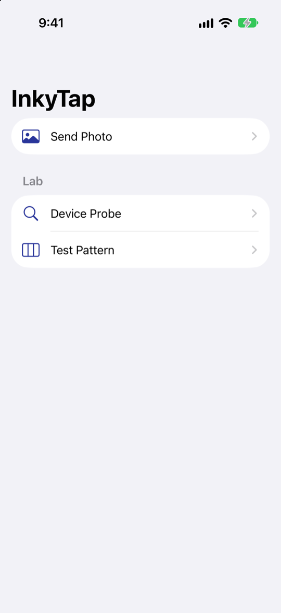
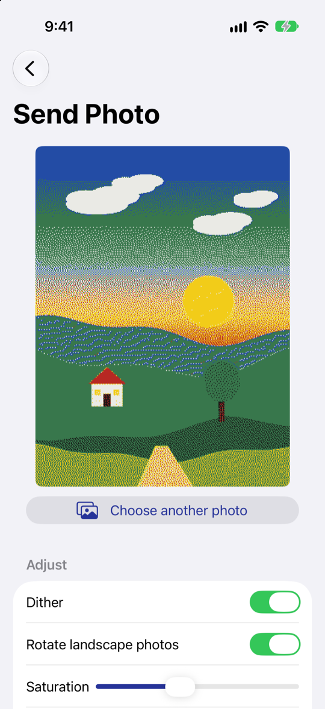
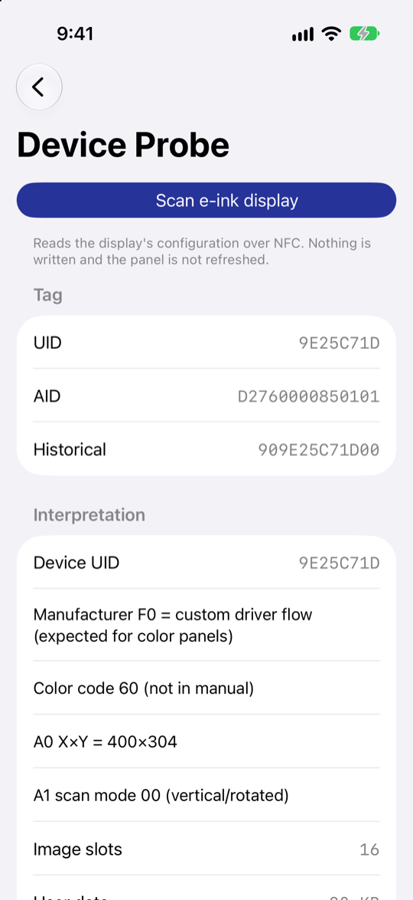
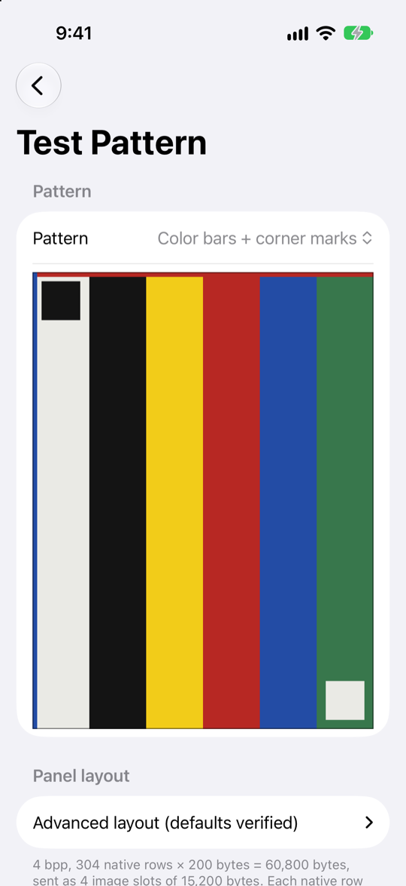

# InkyTap

A developer playground for talking to battery-free NFC e-paper displays
from an iPhone, such as the Tapmora 4-inch Spectra 6 photo magnet and other
displays built on Good Display's FM1280 NFC module. Hold the phone to the
display, and the image is uploaded and refreshed over NFC. No sign-up, no
server.

This repo is the lab version: it keeps the device probe, test patterns, and
raw layout toggles alongside the photo sender so the protocol can be explored
and verified on real hardware. The protocol findings live in
[`docs/nfc-protocol-notes.md`](docs/nfc-protocol-notes.md). A polished
App Store app is developed separately.

Built with SwiftUI for iOS 26+.

| Home | Send Photo | Device Probe | Test Pattern |
|:---:|:---:|:---:|:---:|
|  |  |  |  |

## Building

The Xcode project is generated from `project.yml` with
[xcodegen](https://github.com/yonaskolb/XcodeGen), so `InkyTap.xcodeproj` is
not committed.

```sh
make project   # regenerate InkyTap.xcodeproj
make sim       # run on the iPhone 17 simulator
make device    # build + install + launch on a USB-connected iPhone
make open      # open in Xcode
```

Core NFC only works on a physical iPhone. For device builds, copy
`Signing.xcconfig.example` to `Signing.xcconfig` and set your Apple team ID;
the file is gitignored. Xcode registers the bundle ID
`io.github.donny.inkytap` under your team automatically, or change
`bundleIdPrefix` in `project.yml` to use your own.

## What's inside

- **Send Photo**: pick a photo, adjust saturation/contrast/brightness, dither to
  the six-color palette, and send it.
- **Device Probe**: reads the display's configuration records over NFC and
  shows the decoded values; copy the report when adding support for a new
  display.
- **Test Pattern**: color bars and solid fills with layout toggles for
  working out a panel's framebuffer format.

Screenshots are produced by `scripts/screenshots.sh`, which launches the
simulator build with the debug-only `INKYTAP_SCREEN` environment variable to
open each screen with sample data.

## Status

- Verified on a Tapmora 4-inch Spectra 6 (300x400, six colors).
- Other display sizes and color modes reported by the device are not yet
  supported.

## Disclaimer

InkyTap is an independent project. It is not affiliated with, endorsed by, or
supported by Tapmora, Good Display (Guangdong SID Technology), Fudan
Microelectronics, E Ink, or the makers of the Einky app. Product names are
used only to describe compatibility and remain the property of their owners.

The protocol was implemented from the publicly published FM1280 developer
manual and existing open-source projects, for interoperability. Nothing from
the Einky app was copied or decompiled.

Use at your own risk. Writing to a display with an unsupported configuration
may leave it showing garbage until the next successful upload.

## License

MIT, see [LICENSE](LICENSE). Third-party code is listed in
[THIRD_PARTY_NOTICES.md](THIRD_PARTY_NOTICES.md).
